# 📚 PageHaven Bookstore & Curated E-Library — Full Deployment & Architecture Guide

A full-stack, archival bookstore and digital lending e-library web application built with **React 18 + Vite + Tailwind CSS**, powered by a **Node.js / Express.js REST API**, and backed by **MongoDB**.

---

## 🏛️ System Architecture

```mermaid
flowchart LR
    subgraph Client ["Frontend (React 18 + Vite)"]
        UI["Tailwind CSS 3 + Newsreader & Jakarta Sans"]
        State["BookstoreContext State Management"]
        Views["Home | Fiction | Comics | Manga | Wisdom | Periodicals | AI Concierge | Returns | Hub"]
    end

    subgraph API ["Backend (Node.js & Express.js)"]
        Routes["REST Endpoints (/api/books, /api/auth, /api/orders, /api/library, /api/concierge, /api/returns)"]
        Auth["JWT Token Authentication & Bcrypt Hashing"]
        Concierge["ReadGenius AI Advisor Engine"]
    end

    subgraph Storage ["Database (MongoDB)"]
        Mongo["MongoDB Atlas / Local MongoDB"]
        Collections["Books | Users | Orders | BorrowRecords | ReturnRequests"]
    end

    Client -->|REST API Requests / JSON| API
    API -->|Mongoose ODM / Auto-Seed| Storage
```



---

## 🗂️ Project Directory Structure

```
bookstore_and_e_library/
├── frontend/                     # React + Vite Client Application
│   ├── public/
│   │   └── covers/              # 70+ local high-resolution book, manga & magazine covers
│   ├── src/
│   │   ├── components/
│   │   │   ├── Header.jsx              # Navigation header, search bar, bag counter & profile
│   │   │   ├── AnnouncementRibbon.jsx  # Autumn Salon PAGE25 voucher banner
│   │   │   ├── HeroSpotlight.jsx       # The Midnight Library illuminated centerpiece
│   │   │   ├── CuratedShelf.jsx        # Horizontal & grid salon book shelves
│   │   │   ├── BookCard.jsx            # Book cover, spine shadow, pricing, quick actions
│   │   │   ├── BookDetailModal.jsx     # High-res reader preview, specs & edition selector
│   │   │   ├── ReadingBagDrawer.jsx    # Cart slide-over with promo code & free shipping bar
│   │   │   ├── CheckoutModal.jsx       # Order address, payment selection & confirmation
│   │   │   ├── AuthModal.jsx           # Scholar sign-in & registration
│   │   │   ├── ReadGeniusAI.jsx        # Conversational literary guide with query chips
│   │   │   ├── HelpCareSanctuary.jsx   # 14-day doorstep return scheduler & tracking
│   │   │   ├── AccountLibraryHub.jsx   # E-Library active loans, progress sliders & orders
│   │   │   ├── Footer.jsx              # Archival guarantee, wings list & sanctuary hours
│   │   │   └── Toast.jsx               # Floating toast notifications
│   │   ├── context/
│   │   │   └── BookstoreContext.jsx    # Global state management (bag, loans, auth, toast)
│   │   ├── data/
│   │   │   └── defaultBooks.js         # Curated catalog of 30+ volumes with local images
│   │   ├── services/
│   │   │   └── api.js                  # Centralized fetch client for backend endpoints
│   │   ├── App.jsx                     # Core application orchestrator
│   │   ├── main.jsx                    # React entry point
│   │   └── index.css                   # Custom styles, fonts & Tailwind layers
│   ├── index.html                      # HTML template with Google Fonts (Newsreader, Plus Jakarta)
│   ├── tailwind.config.js              # Stitch design system color palette & typography
│   └── vite.config.js                  # Vite bundler configuration
│
├── backend/                      # Node.js + Express REST API Server
│   ├── config/
│   │   ├── db.js                       # Mongoose connection with automatic fallback
│   │   └── mongo.js                    # MongoDB health check & connection utilities
│   ├── data/
│   │   └── initialBooks.js             # Initial 30+ seed records for database
│   ├── models/
│   │   ├── Book.js                     # Book catalog schema (title, author, genre, price...)
│   │   ├── User.js                     # User schema with bcrypt password hashing
│   │   ├── Order.js                    # Order schema with items, discounts & tracking
│   │   ├── BorrowRecord.js             # 21-day E-Library loan schema with progress tracking
│   │   └── ReturnRequest.js            # 14-day doorstep pickup docket schema
│   ├── routes/
│   │   ├── bookRoutes.js               # /api/books (search, category, spotlight)
│   │   ├── authRoutes.js               # /api/auth (register, login, me)
│   │   ├── orderRoutes.js              # /api/orders (create, my-orders, track)
│   │   ├── libraryRoutes.js            # /api/library (borrowed, borrow, return, progress)
│   │   ├── conciergeRoutes.js          # /api/concierge (ReadGenius AI chat)
│   │   └── returnRoutes.js             # /api/returns (schedule, track)
│   ├── server.js                       # Express app entry point & route mounting
│   ├── package.json                    # Backend dependencies
│   └── .env                            # Backend environment configuration
│
├── .env                          # Master environment variables (MongoDB URI, JWT, Ports)
├── .env.example                  # Environment variable template for production
├── .gitignore                    # Git ignore file for secrets and dependencies
├── mongo.js                      # Root MongoDB connection module
├── package.json                  # Root runner script package
└── DEPLOYMENT_GUIDE.md           # This comprehensive guide
```

---

## ⚙️ Quick Start for Local Development

### Prerequisites
- **Node.js**: v18.0.0 or higher (Tested with v24.21.0)
- **NPM**: v9.0.0 or higher
- **MongoDB**: (Optional for local testing; backend automatically falls back to curated in-memory data if MongoDB is not running locally).

### 1. Configure Environment Variables
Verify `.env` in the project root:
```env
PORT=5000
NODE_ENV=development
MONGO_URI=mongodb://localhost:27017/pagehaven_db
JWT_SECRET=pagehaven_super_secret_jwt_key_2026_scholar_sanctuary
FRONTEND_URL=http://localhost:5173
VITE_API_URL=http://localhost:5000/api
```

### 2. Start the Backend API
In your terminal:
```bash
cd backend
npm run dev
```
The backend starts on `http://localhost:5000`. If MongoDB is running locally, it automatically connects and seeds all 30+ initial books.

### 3. Start the Frontend Client
In a second terminal:
```bash
cd frontend
npm run dev
```
Open your browser and navigate to:
```
http://localhost:5173
```

---

## 🍃 MongoDB Setup (Local & MongoDB Atlas Cloud)

### Option A: Local MongoDB Community Server
1. Download MongoDB Community Server from [mongodb.com/try/download/community](https://www.mongodb.com/try/download/community).
2. Install and ensure the `mongod` service is started.
3. Your connection URI will be:
   ```env
   MONGO_URI=mongodb://localhost:27017/pagehaven_db
   ```

### Option B: MongoDB Atlas (Free Cloud Cluster)
1. Sign in to [MongoDB Atlas](https://www.mongodb.com/atlas).
2. Create a free **M0 Sandbox** cluster.
3. In **Database Access**, create a user (e.g. `pagehaven_admin`) with a secure password.
4. In **Network Access**, click **Add IP Address** and choose **Allow Access from Anywhere** (`0.0.0.0/0`) for cloud deployment.
5. In **Clusters** → click **Connect** → **Drivers** (Node.js).
6. Copy the connection string into your `.env`:
   ```env
   MONGO_URI=mongodb+srv://pagehaven_admin:<PASSWORD>@cluster0.xxxxx.mongodb.net/pagehaven_db?retryWrites=true&w=majority
   ```

---

## 🌐 Production Deployment Guide

### Step 1: Deploy Database on MongoDB Atlas
Follow Option B above to configure your cloud database cluster and note your `MONGO_URI`.

---

### Step 2: Deploy Backend to Render (or Railway / Heroku)

#### Using Render.com:
1. Push your repository to GitHub.
2. Sign in to [Render](https://render.com) and click **New Web Service**.
3. Select your GitHub repository.
4. Configure the service settings:
   - **Name:** `pagehaven-backend`
   - **Root Directory:** `backend`
   - **Environment:** `Node`
   - **Build Command:** `npm install`
   - **Start Command:** `npm start`
5. Under **Environment Variables**, add:
   | Key | Value |
   |---|---|
   | `NODE_ENV` | `production` |
   | `PORT` | `5000` |
   | `MONGO_URI` | `mongodb+srv://...` (your Atlas URI) |
   | `JWT_SECRET` | `your_secure_random_jwt_secret_key` |
   | `FRONTEND_URL` | `https://your-pagehaven.vercel.app` (or `*`) |
6. Click **Deploy Web Service**. Render will assign an API URL, e.g. `https://pagehaven-backend.onrender.com`.

---

### Step 3: Deploy Frontend to Vercel (or Netlify / Cloudflare Pages)

#### Using Vercel:
1. Sign in to [Vercel](https://vercel.com) and click **Add New Project**.
2. Select your repository.
3. Configure the project settings:
   - **Framework Preset:** `Vite`
   - **Root Directory:** `frontend`
   - **Build Command:** `npm run build`
   - **Output Directory:** `dist`
4. Under **Environment Variables**, add:
   | Key | Value |
   |---|---|
   | `VITE_API_URL` | `https://pagehaven-backend.onrender.com/api` |
5. Click **Deploy**. Your frontend is live with automatic SSL, worldwide CDN, and instant updates on git push!

---

## 📡 REST API Reference

| Method | Endpoint | Description |
|---|---|---|
| `GET` | `/api/books` | Get catalog with category, search & sort filters |
| `GET` | `/api/books/spotlight` | Get illuminated masterpiece (*The Midnight Library*) |
| `GET` | `/api/books/:id` | Get single book details & reviews |
| `POST` | `/api/auth/register` | Register new Scholar account |
| `POST` | `/api/auth/login` | Scholar login (returns JWT token) |
| `GET` | `/api/auth/me` | Fetch active authenticated scholar profile |
| `POST` | `/api/orders` | Place book acquisition order with White-Glove delivery |
| `GET` | `/api/orders/my-orders` | Fetch scholar hardcopy deliveries and order dockets |
| `GET` | `/api/orders/track/:id` | Real-time parcel telemetry and delivery milestones |
| `GET` | `/api/library/borrowed` | Fetch active 21-day E-Library loans |
| `POST` | `/api/library/borrow/:id`| Borrow volume for 21 days with cloud synchronization |
| `POST` | `/api/library/return/:id`| Return borrowed volume to digital stacks |
| `PUT` | `/api/library/progress/:id`| Update reading percentage (0–100%) |
| `POST` | `/api/concierge/chat` | Consult ReadGenius AI Literary Guide |
| `POST` | `/api/returns/schedule` | Schedule 14-day doorstep return courier |
| `GET` | `/api/returns/track/:id`| Check doorstep pickup courier status |
| `GET` | `/api/health` | Backend & MongoDB connectivity health check |

---

## 💡 Archival Features Built-in

- **Voucher `PAGE25`**: Apply in the reading bag or top announcement ribbon for 25% instant archival savings.
- **Free White Glove Shipping**: Unlocked automatically when order subtotal reaches $50.00.
- **Doorstep Courier Returns**: Courier arrives at the user's reading desk with no boxes or labels needed.
- **ReadGenius AI Advisor**: Delivers personalized recommendations, thematic breakdowns, and policy assistance.
- **Seamless Offline / In-Memory Resilience**: If MongoDB is not reachable or pending credentials, the backend functions without throwing unhandled exceptions.
