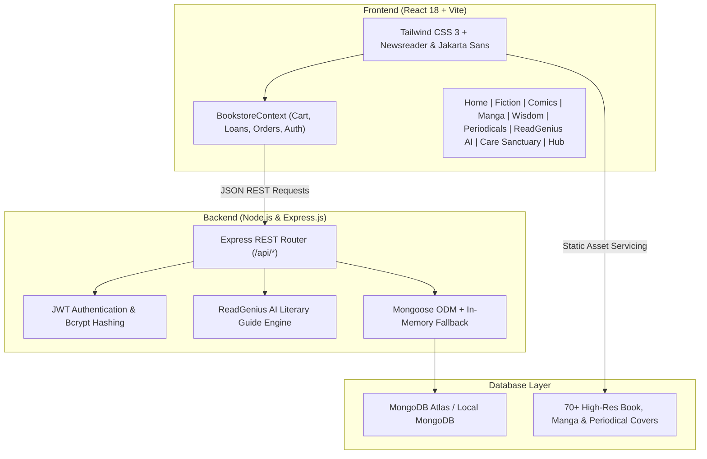

# 📚 PageHaven — Sanctuary of Rare Books & Curated E-Library

[](https://reactjs.org/)
[](https://vitejs.dev/)
[](https://tailwindcss.com/)
[](https://nodejs.org/)
[](https://expressjs.com/)
[](https://www.mongodb.com/)
[](LICENSE)

An archival bookstore and digital lending e-library web application built with **React 18 + Vite + Tailwind CSS**, powered by a **Node.js / Express.js REST API**, and backed by **MongoDB**. Converted directly from high-fidelity Google Stitch UI/UX design specifications into a production-ready application.

---

## 🏛️ System Architecture



---

## ✨ Key Features & Wings

### 🌟 1. Archival Bookstore & Catalog
- **Illuminated Masterpiece Spotlight**: Centerpiece hero showcasing *The Midnight Library* by Matt Haig with gilded hardbound specs, literary pull quotes, and instant acquisition or digital lending options.
- **Curated Wings & Salons**:
  - **Story & Acclaimed Fiction**: Toshikazu Kawaguchi, Kazuo Ishiguro, Madeline Miller, Gabrielle Zevin.
  - **Comics & Graphic Novel Epics**: *Watchmen* (Deluxe Slipcase), *The Sandman*, *Batman: Year One*, *Lore Olympus*, *Heartstopper*.
  - **Anime & Manga Vault**: Authentic Japanese tankobon prints for *One Piece: Wano Country*, *Attack on Titan*, *Chainsaw Man*, *Spy x Family*, *Frieren: Beyond Journey's End*.
  - **Motivational & Human Wisdom**: *Atomic Habits*, *Man's Search for Meaning*, *Can't Hurt Me*, *The Courage to Be Disliked*.
  - **Periodicals, GK & University Stacks**: Heavy artboard issues of *Vogue*, *Forbes 2025*, *Architectural Sanctuary*, *Current Affairs Yearbook 2025*, and university textbooks (*Principles of Modern Physics*, *Campbell Biology*, *Constitutional Law*, *Microeconomics*).
- **Faceted Filters & Sorting**: Real-time category filtering, live omni-search, and sorting by curated status, price, or scholarly review rating.

### 📖 2. Digital E-Library Lending System
- **21-Day Complimentary Loans**: Borrow any cataloged volume with one click into your personal digital study.
- **Synchronized Reading Progress**: Interactive progress slider (0% to 100%) tracking reading completion and active days remaining.
- **Reading Streaks & Scholarly Stats**: Live counters for consecutive reading days and finished folios.

### 🤖 3. ReadGenius AI Literary Guide & Concierge
- **Conversational Literary Advice**: Real-time intelligent AI advisor trained on canonical archives and bookstore inventory.
- **One-Click Query Chips**: Instant inquiries regarding philosophical fiction, graphic novels, stoicism picks, or return policies.
- **Contextual Book Recommendations**: Recommends related folios that can be inspected directly from the chat dialogue.

### 🛍️ 4. Reading Bag & White-Glove Checkout
- **Slide-Out Reading Bag Drawer**: Live quantity adjustments, item removals, and subtotal calculation.
- **Archival Privilege Voucher (`PAGE25`)**: Instant 25% discount application with one-click copy ribbon.
- **Free White-Glove Shipping Progress**: Visual progress bar unlocking complimentary archival delivery for orders over $50.00.
- **Complete Checkout Modal**: Secure address fields and multiple payment methods (Credit Card, UPI / NetBanking, Cash on Delivery).

### 🚚 5. Help Care Sanctuary & 14-Day Doorstep Returns
- **Doorstep Return Scheduler**: Courier pickup scheduling straight from the scholar's desk with no printing or repacking required.
- **Real-Time Parcel Logistics Telemetry**: Live milestone tracking (*Sanctuary Sealed* ➔ *Courier Handover* ➔ *Out for Delivery* ➔ *Delivered*).
- **Preservation FAQs**: Comprehensive accordion answering archival paper preservation, Smyth-sewn binding, and humidity standards.

---

## 📁 Repository Structure

```
bookstore_and_e_library/
├── frontend/                       # React 18 + Vite Application
│   ├── public/
│   │   └── covers/                # 70+ high-resolution book, manga & magazine covers
│   ├── src/
│   │   ├── components/            # UI components matching Stitch design
│   │   │   ├── Header.jsx         # Sticky header with search, bag badge & profile
│   │   │   ├── AnnouncementRibbon.jsx # Voucher banner with 1-click copy
│   │   │   ├── HeroSpotlight.jsx  # Illuminated Masterpiece spotlight section
│   │   │   ├── CuratedShelf.jsx   # Curated horizontal & grid book shelves
│   │   │   ├── BookCard.jsx       # 3D spine-shadow book card with badges
│   │   │   ├── BookDetailModal.jsx# Excerpt preview reader & edition selector
│   │   │   ├── ReadingBagDrawer.jsx# Slide-out cart with coupon & free shipping bar
│   │   │   ├── CheckoutModal.jsx  # Order address, payment & confirmation
│   │   │   ├── AuthModal.jsx      # Scholar sign in & registration
│   │   │   ├── ReadGeniusAI.jsx   # Conversational AI literary guide
│   │   │   ├── HelpCareSanctuary.jsx # 14-day return scheduler & tracking
│   │   │   ├── AccountLibraryHub.jsx # E-Library shelf, loan sliders & orders
│   │   │   ├── Footer.jsx         # Sanctuary links, hours & archival pledge
│   │   │   └── Toast.jsx          # Feedback notifications
│   │   ├── context/
│   │   │   └── BookstoreContext.jsx # Central state management
│   │   ├── data/
│   │   │   └── defaultBooks.js    # Pre-seeded catalog of 30+ volumes
│   │   ├── services/
│   │   │   └── api.js             # Centralized Fetch API client
│   │   ├── App.jsx                # Application root with view router
│   │   ├── main.jsx               # React DOM entry point
│   │   └── index.css              # Custom styles, fonts & Tailwind layers
│   ├── index.html                 # Google Fonts (Newsreader, Plus Jakarta Sans)
│   ├── tailwind.config.js         # Stitch color palette & typography tokens
│   ├── vite.config.js             # Vite configuration
│   └── package.json               # Frontend dependencies
│
├── backend/                        # Node.js & Express REST API Server
│   ├── config/
│   │   ├── db.js                  # Mongoose connection with resilient fallback
│   │   └── mongo.js               # MongoDB health check utility
│   ├── data/
│   │   └── initialBooks.js        # Seed catalog data for 30+ volumes
│   ├── models/
│   │   ├── Book.js                # Books schema
│   │   ├── User.js                # Users schema with bcrypt password hashing
│   │   ├── Order.js               # Orders & parcel tracking schema
│   │   ├── BorrowRecord.js        # 21-day digital loans schema
│   │   └── ReturnRequest.js       # Doorstep courier pickup schema
│   ├── routes/
│   │   ├── bookRoutes.js          # /api/books (search, category, spotlight)
│   │   ├── authRoutes.js          # /api/auth (register, login, me)
│   │   ├── orderRoutes.js         # /api/orders (create, my-orders, track)
│   │   ├── libraryRoutes.js       # /api/library (borrowed, borrow, return, progress)
│   │   ├── conciergeRoutes.js     # /api/concierge/chat (ReadGenius AI)
│   │   └── returnRoutes.js        # /api/returns (schedule, track)
│   ├── server.js                  # Express server & route mounting
│   ├── package.json               # Backend dependencies
│   └── .env                       # Backend environment variables
│
├── .env                            # Master environment variables (MongoDB URI, JWT, Ports)
├── .env.example                    # Environment variable template for production
├── .gitignore                      # Git ignore rules for node_modules, build & secrets
├── mongo.js                        # Dedicated MongoDB connection module
├── DEPLOYMENT_GUIDE.md             # Full production deployment guide (Vercel, Render, Atlas)
├── package.json                    # Workspace runner script
└── README.md                       # Project documentation
```

---

## 🛠️ Technology Stack

| Domain | Technology | Purpose |
|---|---|---|
| **Frontend Framework** | React 18 | Declarative component UI |
| **Build Tool** | Vite 5 | Fast HMR & production bundling |
| **Styling** | Tailwind CSS 3 | Custom design system matching Stitch |
| **Typography** | Newsreader & Plus Jakarta Sans | Editorial serif headings & geometric UI sans-serif |
| **Icons** | Google Material Symbols Outlined | Clean iconography |
| **Backend Runtime** | Node.js (ES Modules) | Server execution |
| **Web Framework** | Express.js 4 | REST API routing & middleware |
| **Database & ODM** | MongoDB & Mongoose 8 | Document database & data schemas |
| **Security & Auth** | JSON Web Tokens (JWT) & BcryptJS | Scholar session management & password hashing |

---

## 🚀 Getting Started

### Prerequisites
- [Node.js](https://nodejs.org/) (v18.0.0 or higher)
- [NPM](https://www.npmjs.com/) (v9.0.0 or higher)
- [MongoDB](https://www.mongodb.com/) (Optional: the backend automatically functions with an in-memory repository if MongoDB is not running locally).

### 1. Clone the Repository
```bash
git clone https://github.com/your-username/bookstore_and_e_library.git
cd bookstore_and_e_library
```

### 2. Configure Environment Variables
Copy `.env.example` to `.env` in the root folder:
```bash
cp .env.example .env
```
Ensure your `.env` contains:
```env
PORT=5000
NODE_ENV=development
MONGO_URI=mongodb://localhost:27017/pagehaven_db
JWT_SECRET=pagehaven_super_secret_jwt_key_2026_scholar_sanctuary
FRONTEND_URL=http://localhost:5173
VITE_API_URL=http://localhost:5000/api
```

### 3. Run the Backend Server
```bash
cd backend
npm install
npm run dev
```
The backend starts at `http://localhost:5000`. Health check available at `http://localhost:5000/api/health`.

### 4. Run the React Frontend Client
In a new terminal window:
```bash
cd frontend
npm install
npm run dev
```
Open your browser at `http://localhost:5173`.

### 5. Build for Production
To build the frontend production bundle:
```bash
cd frontend
npm run build
```
Compiled output will be placed in `frontend/dist/`.

---

## 📡 REST API Reference

| Method | Endpoint | Description |
|---|---|---|
| `GET` | `/api/books` | Fetch books with optional category, search, and sort query parameters |
| `GET` | `/api/books/spotlight` | Fetch the current illuminated masterpiece (*The Midnight Library*) |
| `GET` | `/api/books/:id` | Fetch complete folio details, ISBN, and synopsis |
| `POST`| `/api/auth/register` | Register a new Scholar account (`name`, `email`, `password`) |
| `POST`| `/api/auth/login` | Scholar login (returns signed JWT token) |
| `GET` | `/api/auth/me` | Fetch active authenticated scholar profile |
| `POST`| `/api/orders` | Place book acquisition order with White-Glove delivery |
| `GET` | `/api/orders/my-orders` | Fetch scholar hardcopy deliveries and parcel dockets |
| `GET` | `/api/orders/track/:id` | Real-time parcel telemetry and delivery milestones |
| `GET` | `/api/library/borrowed` | Fetch active 21-day digital E-Library loans |
| `POST`| `/api/library/borrow/:id`| Borrow volume for 21 days with cloud sync |
| `POST`| `/api/library/return/:id`| Return borrowed volume back to digital stacks |
| `PUT` | `/api/library/progress/:id`| Update reading completion percentage (0–100%) |
| `POST`| `/api/concierge/chat` | Consult ReadGenius AI Literary Guide |
| `POST`| `/api/returns/schedule` | Schedule 14-day doorstep return courier pickup |
| `GET` | `/api/returns/track/:id`| Check doorstep pickup courier status |
| `GET` | `/api/health` | Health check verifying server and MongoDB connection state |

---

## 🍃 MongoDB Configuration

You can connect to either a local MongoDB instance or a cloud MongoDB Atlas cluster:

### Local MongoDB:
```env
MONGO_URI=mongodb://localhost:27017/pagehaven_db
```

### MongoDB Atlas Cloud:
```env
MONGO_URI=mongodb+srv://<username>:<password>@<cluster>.mongodb.net/pagehaven_db?retryWrites=true&w=majority
```

*Note: Dedicated connection module is located at [mongo.js](file:///c:/Users/kumar/OneDrive/Nisha/bookstore_and_e_library/mongo.js).*

---

## ☁️ Deployment Summary

For full step-by-step instructions with screenshots and environment tables, see [DEPLOYMENT_GUIDE.md](file:///c:/Users/kumar/OneDrive/Nisha/bookstore_and_e_library/DEPLOYMENT_GUIDE.md).

- **Frontend Deployment (Vercel / Netlify)**:
  - Framework: `Vite`
  - Root directory: `frontend`
  - Build command: `npm run build`
  - Output directory: `dist`
  - Environment variable: `VITE_API_URL=https://your-backend-service.onrender.com/api`
- **Backend Deployment (Render / Railway)**:
  - Root directory: `backend`
  - Build command: `npm install`
  - Start command: `npm start`
  - Environment variables: `PORT`, `NODE_ENV=production`, `MONGO_URI`, `JWT_SECRET`, `FRONTEND_URL`
- **Database (MongoDB Atlas)**:
  - Free M0 tier with IP Whitelist set to `0.0.0.0/0`.

---

## 📄 License

This project is licensed under the ISC License.
